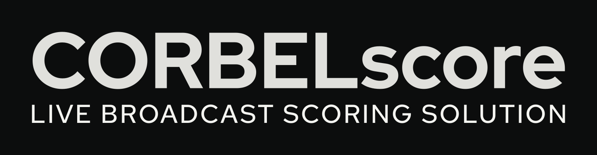
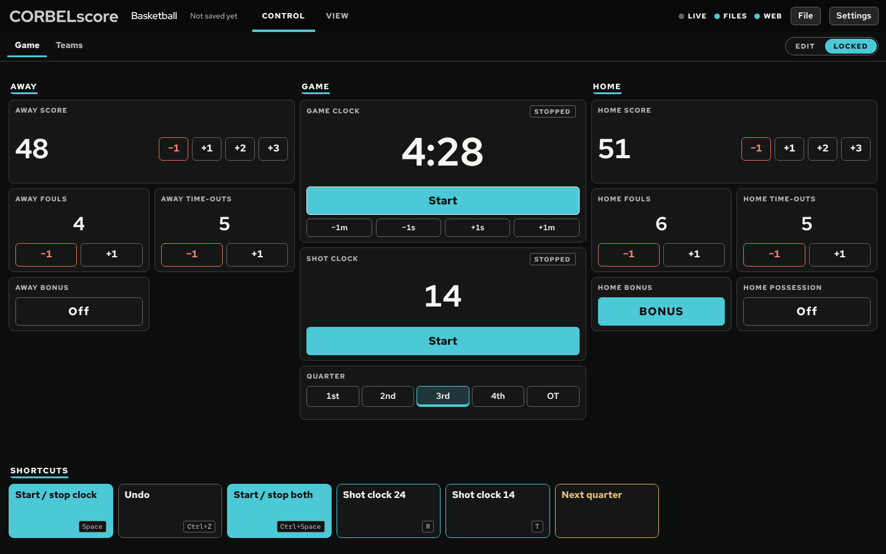
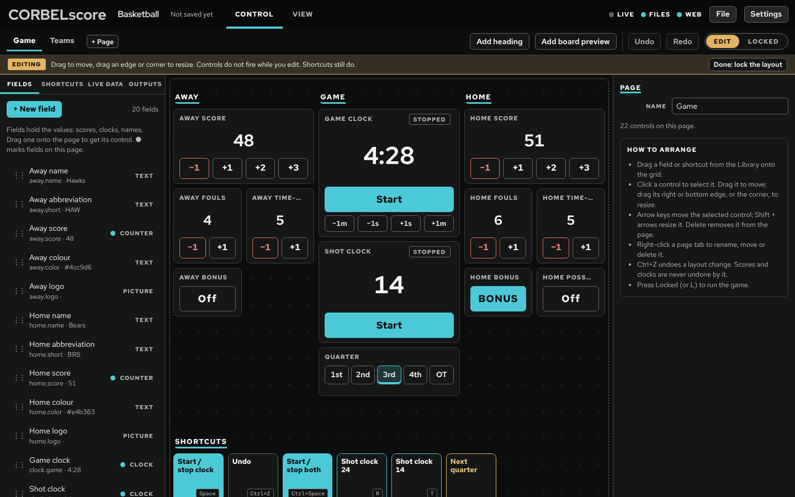
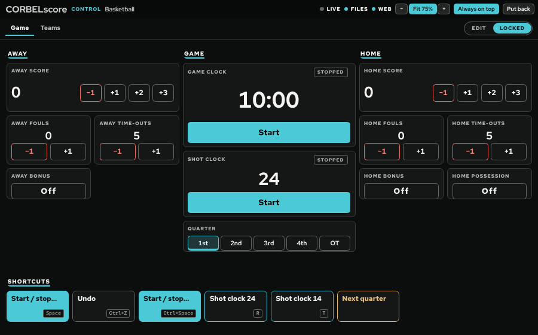
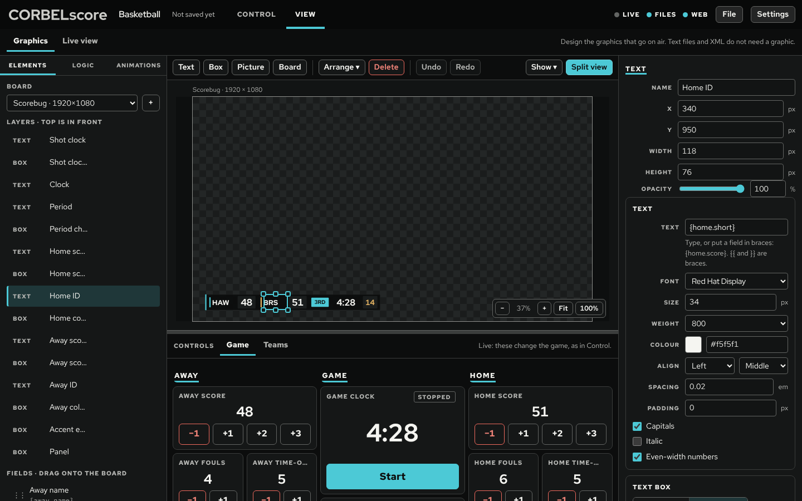
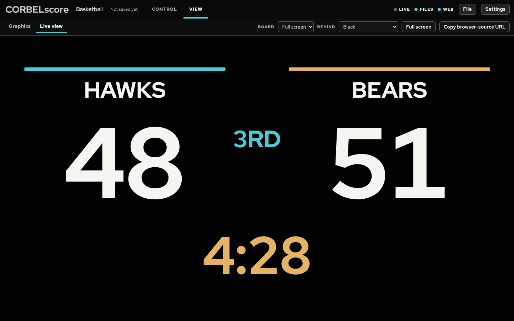
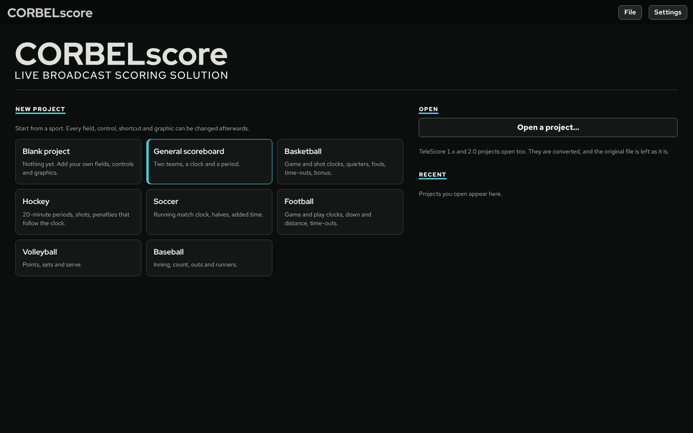

# CORBELscore

Live broadcast scoring solution. Keep score in one window. The scores go out as text files, XML (generic, vMix, Ross XPression, Chyron), JSON, browser sources for OBS and vMix, PNG pictures and a full-screen projector window.



## Download

Get **CORBELscore.exe** from [Releases](https://github.com/rohzino/CORBELscore/releases) (Windows 10 or 11, 64-bit). It is the whole program in one file: double-click it, no installer. The first run takes a few seconds to set up; after that it opens straight away. It is not code-signed yet, so Windows SmartScreen may say it "protected your PC": choose **More info → Run anyway**.

## What it does

CORBELscore has two tabs.

**Control** is where you run the game and where you arrange how you run it. A switch at the top right flips it between two modes:

- **Locked** (for the game): your controls fill the window and every button is live. Rows stretch so a page fits the screen without scrolling.
- **Edit** (for setting up): the controls become a layout you arrange, between two side panels.
  - Left, the **Library**: Fields, Shortcuts, Live data and Outputs. Drag a field or shortcut onto the page to get its control.
  - Middle, the **layout**: a 24-column grid. Drag to move, drag an edge or corner to resize, or use the arrow keys (Shift + arrows resizes). Other controls move out of the way.
  - Right, **Properties** of whatever is selected: the control's size, the field's rules, live key and override, a shortcut's steps and key.

  Controls do not fire while you edit, so nothing goes to air by accident; shortcuts still work. An amber EDITING band and a dotted grid make the mode impossible to miss. Ctrl+Z undoes layout and design changes but never rewinds a score or a clock.



Controls are grouped into **pages** (Game, Teams, …) like a Stream Deck or Companion: right-click a page tab to rename, move or delete it. Each field type has its own control: clocks with Start/Stop, ±1 s and ±1 min; counters with their steps; choices as a row of buttons; on/off, text, penalties and pictures. **Shortcuts** are your own actions: each runs several steps as one undo step ("Next quarter: next period, reset game clock, reset shot clock"). Put one on a page as a button, give it a key, or both; a shortcut that is on no page still works by its key.

**View** is what goes out, in two sections:

- **Graphics**, the scoreboard designer. Boards are fixed canvases (1920 × 1080 by default), drawn like a document in a photo editor: the board is framed and labelled, the pasteboard around it dimmed, with optional title- and action-safe guides. Elements snap to each other and to the board; resize from any edge or handle; align, distribute, reorder, copy and paste, zoom and pan. Drag a field onto the board to show it.
  - **Text** is Auto width (the box hugs the words and grows from its alignment, like an OBS text source) or Fixed width (a box the text wraps and shrinks inside). Fonts come from a list: the four that ship with CORBELscore, then the computer's own.
  - **Pictures** arrive at their own size; one bigger than the board offers to fit itself.
  - **Boards inside boards**: put a sponsor bug or a lower third inside the scorebug. It gets an On air switch on the control page, so the operator puts it up and takes it down.
  - **Opacity** for every element, as a percentage.
  - **Split view** shows your live controls under the board, so you can change scores and clocks while you design.
  - Colours can follow fields such as `{home.color}`. Here too are:
  - **Logic**: SportzSuite-style conditions, such as "if `home.timeouts` changes by -1, animate the time-out graphic" or "if the clock has value 0:00, show FINAL". With rules (`0:00=FINAL`) and overrides they shape the text and XML files as well as the graphics. See [docs/logic.md](docs/logic.md).
  - **Animations**: thirty-one built-in moves (fly, wipe, fade, slide, pop, drop, flash, pulse, shake, bump) and your own recipes, previewed on the canvas.
- **Live view**: any board, live, against checks, black or green, full screen or in a projector window on another display, with its browser-source URL one click away.



**Pop out** either tab into a window of its own (Ctrl + Shift + P): any size, on any screen, with an **Always on top** switch so the controls stay in front of OBS or vMix. Everything in the window scales with it (**Fit**), or pick 50% to 200% with − and +. Each pop-out remembers its size, place and settings; **Put back** (or closing it) returns it to the main window.





Also:

- **Live data** from Sportzcast over MQTT (cloud or a local ScoreConnect III / Scorelink+), the legacy socket, or a LiveXML / JSON file or URL. It connects only when you press Connect. Bind its keys to fields with one click. See [docs/sportzcast.md](docs/sportzcast.md).
- **Templates**: basketball, hockey, soccer, football, volleyball, baseball, a general scoreboard and a blank project.
- **Recovery.** Unsaved work is kept, and offered back if CORBELscore closes unexpectedly.
- **TeleScore projects open directly**. They are converted, and the original file is never overwritten.

Clocks keep time in milliseconds from the system clock, so they never drift and a pause keeps the fraction already run. Penalties count down only while their game clock runs.

## Run it

On Windows 10 or 11 (64-bit), double-click **`CORBELscore.bat`**. The first time, it downloads the Electron runtime (about 160 MB) from GitHub into a `runtime` folder, checks its SHA-256 and unpacks it; after that it just starts CORBELscore. Nothing is installed on the computer and no Python or Node is needed. Drag a `.corbel` file onto the launcher to open that project.



| Command | What it does |
|---|---|
| `CORBELscore.bat` | Run CORBELscore |
| `CORBELscore.bat test` | Run the test suite, then a check of the app window, PNG output and shortcuts |
| `CORBELscore.bat build` | Make a portable copy in `dist\CORBELscore` (`CORBELscore.exe`; copy the whole folder) |
| `CORBELscore.bat update` | Download the runtime again |

### One file to share

`CORBELscore.exe` is the whole program in one file (about 160 MB). Double-click it: the first time it unpacks itself to `%LOCALAPPDATA%\CORBELscore` (a few seconds, with a small "Setting up" window); after that it starts straight away. No installer, no administrator rights; a newer `CORBELscore.exe` replaces the old copy by itself. It is not code-signed, so Windows SmartScreen may say it "protected your PC": choose **More info → Run anyway**.

To build it (on Windows, macOS or Linux) you need Go and Python 3:

```
python3 scripts/exe/build.py --electron electron-v44.9.3-win32-x64.zip
```

It checks the runtime's SHA-256, gives `CORBELscore.exe` and the program inside it CORBELscore's icon and version, and writes `dist/CORBELscore.exe`. No other tools are needed.

On other systems, with [Electron](https://www.electronjs.org/) 44 on the path: `electron .` in this folder.

Without a desktop at all (a server, or to use CORBELscore from a browser), run only the service with Node 22 or newer:

```
node app/service/cli.js --port 5170 --preset Basketball
```

It prints the studio address with its key. File dialogs, projector windows, PNG pictures and background shortcuts need the desktop app; everything else works in the browser.

## Outputs at a glance

| Output | Where | Use |
|---|---|---|
| Text | `<folder>/text/home.score.txt` … | OBS Text (GDI+/FreeType) "Read from file" |
| `corbelscore.xml` | file and `http://127.0.0.1:8130/corbelscore.xml` | XPression DataLinq, Chyron: `/corbelscore/home/score` |
| `vmix.xml` | file and URL | vMix Data Sources → XML, XPath `//row` |
| `fields.xml` | file and URL | look-ups by key: `//field[@key='home.score']` (schema: `docs/schema/fields.xsd`) |
| `state.json` | file and URL | anything |
| Browser source | `http://127.0.0.1:8130/board/<id>` | OBS / vMix browser input; add `?bg=green` for a chroma key |
| Remote control | `http://127.0.0.1:8130/api/action?do=add&field=home.score&amount=1` | Stream Deck, Companion |
| PNG | `<folder>/images/<board>.png` | systems that load pictures |

The default folder is `Documents/CORBELscore Output/<project>`. The web server listens only on this computer unless you allow the network in Control → Edit → Outputs. On a network you should set a control token.

### Actions

| `do` | Parameters | What it does |
|---|---|---|
| `add` | `field`, `amount` | Add to a counter (negative subtracts). On a clock, adds seconds. |
| `set` | `field`, `value` | Set any field. Clocks take `12:00`, `45` or `1:30.5`. |
| `reset` | `field` | Reset to the default; a clock goes back to its period length. |
| `toggle`, `start`, `stop` | `field` | Clocks start and stop; `toggle` also flips on/off fields. |
| `adjust` | `field`, `ms` | Add milliseconds to a clock without stopping it. |
| `next`, `prev` | `field` | Step a choice (1st → 2nd) or a counter. |
| `penalty.add` | `field`, `player`, `time` | Add a penalty. |
| `penalty.remove` | `field`, `index` | Remove a penalty. |
| `penalty.clear` | `field` | Remove every penalty. |
| `stop_all` | — | Stop every clock. |
| `undo`, `redo` | — | Undo or redo the last action. |
| `batch` | `actions: [...]` | Run several actions as one undo step. |

## Test

```
npm test            (or: node --test)
```

The tests need nothing installed beyond Node 22:

- **`test/core.test.js`**: time formats, clocks, fields, the engine (actions, undo, penalties), boards, projects and templates.
- **`test/service.test.js`**: the files on disk, the web server (feeds, boards, remote control and its token), the studio API's guard, design undo, and the layout maths.
- **`test/logic.test.js`**: rules, overrides and conditions.
- **`test/legacy.test.js`**: 1.x project import.
- **`test/sportzcast.test.js`**: fake MQTT brokers, legacy sockets and LiveXML files.
- **`test/ui.test.js`**: drives the studio window in Chromium, if Playwright is installed (skipped otherwise).

`CORBELscore.bat test` runs the same suite inside the downloaded runtime, so Windows needs no Node.

## Project layout

```
app/core      engine: fields, clocks, actions + undo, rules and conditions, boards, layout,
              animations, projects, templates, 1.x import        (plain JS, shared with the window)
app/service   the service: outputs, web servers, live data, files, settings, studio API (Node)
app/ui        the studio window (HTML, CSS, JS modules) and the shared board renderer
app/main.js   the desktop shell (Electron): window, dialogs, projector, PNG, shortcuts
test/         node --test suites
docs/         logic, Sportzcast, UI principles, OBS plugin plan, XSD for fields.xml
```

There are no npm dependencies.

The look is CORBELscore's own design system ([docs/design-system.md](docs/design-system.md)): Basalt black, Limestone cream (Pantone P 179-1 U) and Patina cyan, with Brass for edit mode and Terracotta for errors; Red Hat Display, Text and Mono; flat surfaces and hairlines; words on buttons; every status a colour and a word. Choose Basalt (dark) or Limestone (light) under Settings. The reasoning behind the layout is in [docs/ui-principles.md](docs/ui-principles.md). Brand files (wordmark, lockup, icon) are in `app/assets/brand/`, rebuilt by `scripts/brand/build.py`.

## Credits

CORBELscore is built on [TeleScore](https://github.com/JumpShot-Interactive/TeleScore), the open-source scoring utility by the JumpShot team (riscyseven, TheLittleDoctor, Fisk31, controldelta, SPCcleveland9035 and Glenn). Its engine, outputs and project format are CORBELscore's building blocks. Like TeleScore, CORBELscore is licensed under the AGPL-3.0.

Red Hat Display, Red Hat Text and Red Hat Mono are © The Red Hat Project Authors (`app/assets/fonts/OFL-RedHat.txt`); Archivo is © The Archivo Project Authors (`app/assets/fonts/OFL-Archivo.txt`). All are under the SIL Open Font License 1.1.

Licensed under the [GNU Affero General Public License v3](LICENSE).
